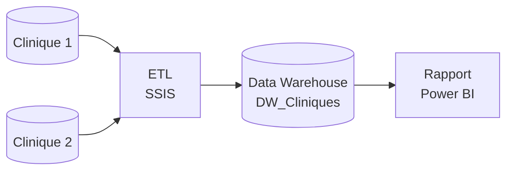

# Data Warehouse et reporting Power BI pour l'analyse de l'activité de cliniques

Projet réalisé lors de mon stage chez **Clinisys** (ENET'Com Sfax).
Conception d'une chaîne décisionnelle complète : ETL SSIS, Data Warehouse en schéma en étoile
sous SQL Server, et rapport Power BI interactif.

> **Note de confidentialité** : ce dépôt ne contient aucune donnée réelle. Les noms de serveurs,
> de bases et de tables du système source ont été remplacés par des exemples fictifs, et les
> données de démonstration sont entièrement générées.

## Contexte et problématique

Les données de deux cliniques (patients, consultations, facturation, activité) étaient dispersées
et consolidées manuellement : reporting lent, qualité des données non maîtrisée, comparaison
N / N-1 difficile.

**Problématique** : comment centraliser et organiser les données des différentes cliniques afin de
disposer d'une vision fiable, tout en permettant aux utilisateurs métier d'analyser facilement les
principaux indicateurs selon différentes périodes et différents axes d'analyse ?

## Solution



| Couche | Technologie | Rôle |
|---|---|---|
| Intégration | SSIS | Extraction, transformation et chargement des deux cliniques |
| Stockage | SQL Server | Data Warehouse en schéma en étoile |
| Restitution | Power BI, DAX | Tableaux de bord interactifs |

Détails : [`docs/architecture.md`](docs/architecture.md).

## Points clés

- **Extensible** : la table pilote `source_liste` et la connexion dynamique permettent d'ajouter une
  clinique sans modifier les packages.
- **Idempotent** : purge par clinique avant rechargement, aucun doublon après plusieurs exécutions.
- **Fiable** : Lookups vers les dimensions, lignes sans correspondance redirigées vers un journal.
- **Analytique** : CA et admissions par jour, mois, année et période libre, comparaison N / N-1,
  analyse par famille de prestations, organisme, nationalité, type d'admission, occupation, centre
  et spécialité du médecin.

## Structure du dépôt

```
clinisys-dw-bi/
├── README.md
├── docs/
│   └── architecture.md              Architecture et modèle (diagrammes)
├── sql/
│   ├── 01_create_dw.sql             Création de DW_Cliniques
│   ├── 02_source_liste_example.sql  Table pilote (valeurs fictives)
│   ├── 03_source_queries_example.sql  Requêtes sources (modèles génériques)
│   └── 04_demo_data_fictive.sql     Données de démonstration fictives
├── ssis/
│   └── README.md                    Documentation des packages ETL
├── powerbi/
│   ├── README.md                    Construction du rapport
│   └── measures.dax                 Table de dates, clés composites, mesures
├── sample_data/                     CSV fictifs (dimensions et faits)
└── .gitignore
```

## Démarrage rapide (sans ETL, avec les données fictives)

1. Exécuter `sql/01_create_dw.sql` pour créer la base et les tables.
2. Exécuter `sql/04_demo_data_fictive.sql` pour charger les données fictives (2 cliniques, 2023-2024).
3. Ouvrir Power BI Desktop, se connecter à `DW_Cliniques`, puis suivre `powerbi/README.md`
   et `powerbi/measures.dax`.

## Démarrage complet (avec l'ETL)

1. Exécuter `sql/01_create_dw.sql`.
2. Renseigner `source_liste` avec vos propres connexions (modèle : `sql/02_source_liste_example.sql`).
3. Adapter les requêtes sources (modèle : `sql/03_source_queries_example.sql`) à votre système.
4. Créer les packages SSIS en suivant `ssis/README.md`, puis exécuter dans l'ordre
   `Dim_Nationalite` → `Dim_Medecin` → `Fact_CA`.
5. Construire le rapport Power BI (`powerbi/README.md`).

## Perspectives

- Extension à de nouvelles cliniques
- Planification des packages (SQL Server Agent)
- Nouveaux indicateurs
- Supervision et alertes en cas d'échec de l'ETL
- Déploiement sur Power BI Service pour un accès partagé

## Auteur

**Younes Abdelkefi**, étudiant en Data Engineering, ENET'Com Sfax.
