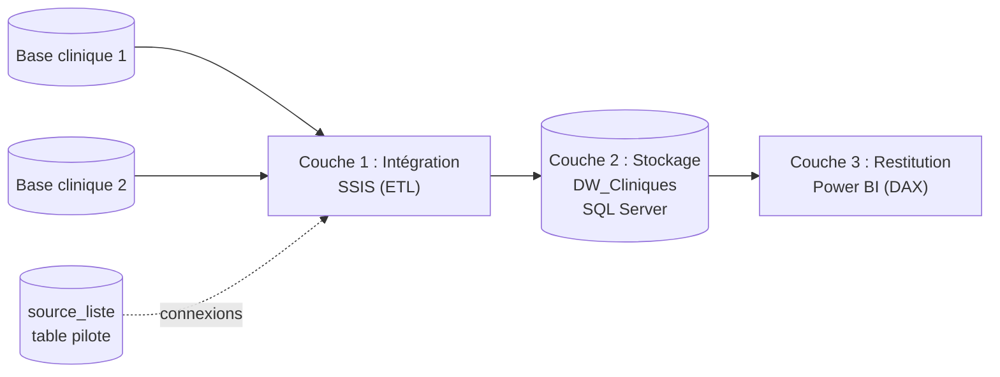
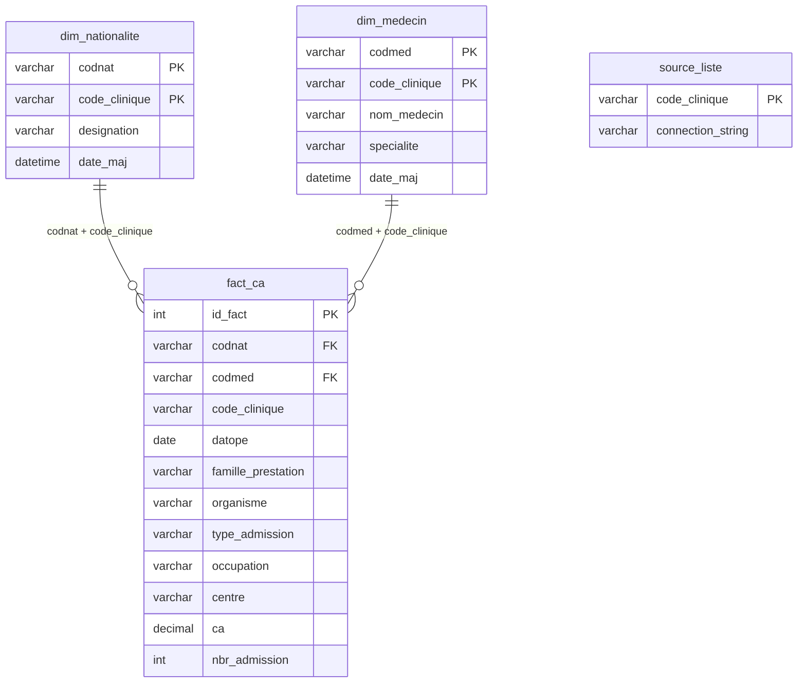

# Architecture de la solution

## Vue d'ensemble

La solution suit une chaîne décisionnelle en trois couches : les données partent des bases
opérationnelles des cliniques, sont intégrées et transformées par l'ETL, stockées dans le
Data Warehouse, puis restituées dans Power BI.

L'ETL est le seul chemin d'alimentation du Data Warehouse : le DW ne contient que des données
déjà extraites, transformées et contrôlées par SSIS.

## Modèle dimensionnel (schéma en étoile)

Les clés des dimensions sont **composites** (clé métier + `code_clinique`) : un même code peut
exister dans les deux cliniques avec une signification différente.

## Choix de conception

| Besoin | Réponse |
|---|---|
| Ajouter une clinique sans modifier le code | Table pilote `source_liste` + connexion dynamique par expression |
| Pas de doublons à chaque exécution | Purge par clinique avant rechargement (idempotence) |
| Données cohérentes avec les dimensions | Lookups vers `dim_nationalite` et `dim_medecin` |
| Erreurs de correspondance sans arrêt du processus | Sortie « sans correspondance » vers un journal |
| Comparaison N / N-1 et périodes variables | Table de dates dédiée et mesures DAX |
| Relations multi-colonnes dans Power BI | Clés composites concaténées (`CleNat`, `CleMed`) |

## Stack technique

SQL Server, SQL Server Integration Services (Visual Studio), Power BI Desktop, DAX.
